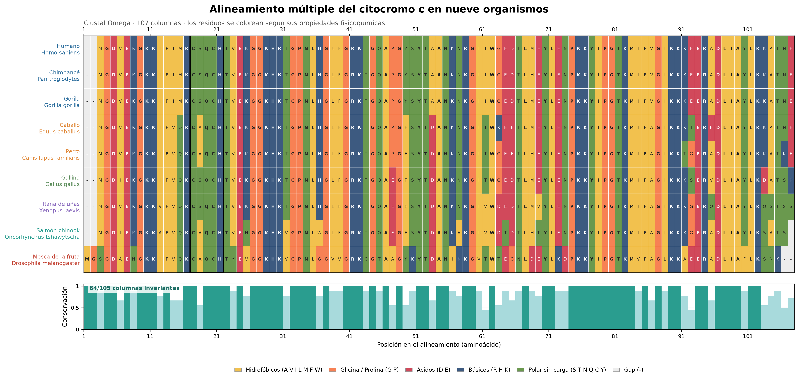
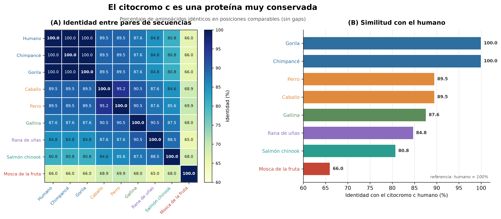
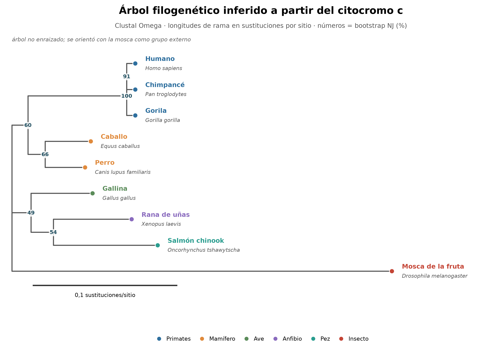

# ¿En qué se parecen una mosca y una gallina?

**TP de Introducción a la Bioinformática**  
**Leonardo Criado** — octubre de 2026  
**Consigna original:** [En qué se parecen una gallina y una mosca](https://github.com/AJVelezRueda/Introduccion_a_la_Bioinformatica/blob/master/Teorico_Practicos/Bioinform%C3%A1tica_Primeros_pasos/En_que_se_parece_una_mosca_y_una_gallina.md), Dra. Ana Julia Velez Rueda (CC BY-SA 4.0).


---

## Qué hice y qué encontré

Tomé las nueve secuencias de citocromo c que pide la consigna, las bajé de NCBI Protein, las alineé con Clustal Omega y armé un árbol con bootstrap. La idea era simple: ver si el parecido entre las proteínas refleja el parentesco entre los organismos.

Lo que salió:

- Los grupos cercanos aparecen claros: primates idénticos y caballo-perro muy parecidos.
- La mosca es el linaje más lejano de la muestra.
- Los nodos profundos entre gallina, rana y salmón no se resuelven.

Mi lectura: el citocromo c alcanza para ver el parentesco cercano y la conservación de la proteína, pero no para reconstruir relaciones profundas. Y hay un detalle que cambia la interpretación: la consigna usa para rana y mosca isoformas parálogas, no las somáticas. Lo cuento al final.

---

## Las secuencias

Bajé las secuencias de NCBI Protein el 21/10/2026 con los números de acceso de la consigna. La Tabla 1 tiene los nombres científicos, los comunes y la comparación de cada una con el citocromo c humano.

**Tabla 1.** Secuencias usadas. La identidad y las diferencias están calculadas sobre posiciones comparables (sin gaps).

| Accesión | Especie | Nombre común | Grupo | Longitud (aa) | Identidad con humano (%) | Diferencias |
|---|---|---|---|---:|---:|---:|
| NP_061820.1 | *Homo sapiens* | Humano | Primates | 105 | 100,0 | 0 |
| NP_001065289.1 | *Pan troglodytes* | Chimpancé común | Primates | 105 | 100,0 | 0 |
| AEP27192.1 | *Gorilla gorilla* | Gorila occidental | Primates | 105 | 100,0 | 0 |
| NP_001157486.1 | *Equus caballus* | Caballo doméstico | Mamífero no primate | 105 | 89,5 | 11 |
| NP_001183974.1 | *Canis lupus familiaris* | Perro doméstico | Mamífero no primate | 105 | 89,5 | 11 |
| NP_001072946.1 | *Gallus gallus* | Gallina doméstica | Ave | 105 | 87,6 | 13 |
| NP_001086101.1 | *Xenopus laevis* | Rana africana de uñas | Anfibio | 105 | 84,8 | 16 |
| XP_024245566.1 | *Oncorhynchus tshawytscha* | Salmón chinook | Pez | 104 | 80,8 | 20 |
| NP_477164.1 | *Drosophila melanogaster* | Mosca de la fruta | Insecto | 105 | 66,0 | 35 |

Dos aclaraciones sobre la tabla:

- El número de posiciones comparables es 105 para casi todos los pares, 104 para el salmón y 103 para la mosca, por gaps en el alineamiento. Por eso las diferencias absolutas no se comparan directo entre filas; el porcentaje sí.
- Las secuencias de rana y mosca no son las isoformas somáticas mayoritarias. Lo discuto en «El detalle de las secuencias».

---

## Cómo lo hice

El alineamiento lo hice con **Clustal Omega**, en el servidor del EBI, con los parámetros por defecto para proteínas. Me dio 107 columnas: dos son gaps en todos los vertebrados porque la mosca tiene dos residuos extra en el extremo N-terminal, y 105 columnas tienen residuos en al menos una secuencia.

Para medir el parecido usé tres cosas:

- **Identidad** sobre posiciones comparables, o sea, sin contar las columnas con gap en alguna de las dos secuencias.
- **Conservación por columna**: fracción de secuencias que comparten el residuo más frecuente.
- **Sitios parsimoniosamente informativos**: columnas con al menos dos estados, cada uno presente en al menos dos secuencias.

Para el árbol usé **neighbor joining con corrección de Poisson** y **1000 réplicas de bootstrap** remuestreando columnas. La topología coincide con el árbol que da Clustal Omega. Como control corrí **IQ-TREE 2** (máxima verosimilitud, modelo WAG+G4): recuperó los grupos cercanos, pero en los nodos profundos se movió y hasta juntó perro con mosca, algo típico de atracción de ramas largas. Por eso el árbol que muestro es el de distancias.

Las figuras las armé con Python (Biopython, Matplotlib y NumPy) a partir del alineamiento. No toqué secuencias ni posiciones a mano.

---

## El alineamiento



**Figura 1.** Alineamiento de las nueve secuencias con Clustal Omega (107 columnas). Cada residuo está coloreado por propiedades fisicoquímicas (leyenda abajo). El recuadro negro marca el motivo CXXCH de unión al hemo (columnas 17-21). Abajo, la conservación por columna: la altura es la fracción de secuencias que comparten el residuo más frecuente.

El alineamiento muestra una proteína muy conservada: 64 de las 105 columnas con residuos (61%) son invariantes y 41 (39%) varían. De esas 41, solo 15 son informativas para la filogenia; el resto son cambios en una sola secuencia o en un solo linaje. Eso ya anticipa que el árbol va a tener poca resolución en los nodos profundos.

El motivo **CXXCH** (Cys15, Cys18 e His19 en la numeración humana, contando la metionina inicial) y la metionina axial (**Met81**) están conservados en las nueve secuencias. Las diferencias se concentran en los extremos y en posiciones sueltas, muchas con cambios conservadores.

La mosca es la que más se despega: dos residuos extra en el N-terminal, gaps en el C-terminal y varias sustituciones propias. El salmón también tiene un gap en el C-terminal.

---

## Qué tan parecidas son



**Figura 2.** (A) Identidad entre todos los pares. (B) Identidad de cada secuencia con el citocromo c humano. Todo calculado sobre posiciones comparables, sin gaps.

Los números que importan:

- **Primates:** humano, chimpancé y gorila, 100% de identidad (0 diferencias).
- **Caballo y perro:** 95,2% (5 diferencias).
- **Gallina y rana:** 90,5% (10 diferencias).
- **Rana y salmón:** 88,5% (12 diferencias).
- **Humano y gallina:** 87,6% (13 diferencias).
- **Mosca:** 66,0% con el humano, y entre 65,0% y 69,9% con el resto.

La identidad no es pareja: hay pares muy pegados y uno claramente aparte. Esa estructura ya sugiere grupos, y es lo que después intenta capturar el árbol.

---

## El árbol



**Figura 3.** Árbol de Clustal Omega (no enraizado, orientado con la mosca como grupo externo). Las longitudes de rama están en sustituciones por sitio. Los números en los nodos son bootstrap (1000 réplicas) de un análisis de distancias NJ con corrección de Poisson sobre el mismo alineamiento. La topología coincide con la de Clustal Omega.

El árbol recupera estos grupos, con el soporte de bootstrap:

- **Primates:** 100%.
- **Humano-chimpancé:** 91%.
- **Caballo-perro:** 66%.
- **Mamíferos** (primates + caballo + perro): 60%.
- **Gallina, rana y salmón:** 49%.
- **Rana y salmón:** 54%.
- **Mosca** como grupo externo: 100%.

Dicho rápido: el árbol sirve para afirmar que humano, chimpancé y gorila están muy cerca y que la mosca es el linaje más lejano. No sirve para decidir el orden exacto entre gallina, rana y salmón: esos nodos tienen soporte bajo (49-60%), así que no tienen respaldo suficiente en estos datos.

---

## Las preguntas de la consigna

### ¿Cuán sencillo será alinear dos o más secuencias a mano? ¿Cuánto influirán el número de secuencias, su longitud y su similitud?

Con dos secuencias cortas y parecidas, podemos intentar a mano. Con nueve secuencias de ~105 aminoácidos y 41 posiciones variables, ya no. La dificultad crece con tres cosas:

- **Número de secuencias:** las comparaciones son n(n-1)/2. Con 9 hay 36 pares, y además hay que hacerlos consistentes entre todos, no de a pares.
- **Longitud:** cada posición nueva agrega alternativas de gaps y de correspondencias.
- **Similitud:** cuanto menos parecidas son, más ambiguo es decidir qué residuo va con cuál.

Y hay un problema práctico: un alineamiento manual no es reproducible y es fácil sesgarlo hacia lo que «se ve bien». Por eso lo práctico es usar un programa (Clustal, MAFFT, MUSCLE) y revisar si el resultado cambia con otros parámetros.

### ¿Son parecidos los citocromos c de humano y gallo?

Sí, bastante: 87,6% de identidad, 92 aminoácidos iguales y 13 cambios sobre 105 posiciones. El núcleo funcional (CXXCH y la metionina axial) está conservado. Para organismos separados por más de 300 millones de años, es un parecido enorme. La explicación más directa es la restricción funcional: la proteína tiene que seguir haciendo su trabajo, y la selección purificadora eliminó casi todos los cambios que la rompían.

### ¿Qué teorías subyacen a este análisis?

Tres ideas, básicamente:

- **Descendencia común:** las secuencias comparten un ancestro.
- **Evolución molecular:** los cambios se acumulan con el tiempo (Zuckerkandl y Pauling).
- **Neutralismo y selección:** muchas sustituciones son neutras, pero las posiciones críticas están bajo selección purificadora.

A eso le agrego dos supuestos prácticos: que las secuencias son **ortólogas** (no parálogas) y que el alineamiento representa posiciones homólogas. Si esos supuestos fallan, el árbol se distorsiona.

### ¿Cómo nos ayuda la evolución a explicar sus similitudes y diferencias?

El parecido viene del ancestro común y de la conservación funcional: cuanto más reciente el ancestro, menos cambios. Las diferencias vienen de mutaciones que se fijaron y del tiempo desde la divergencia. La mosca, separada de los vertebrados hace cientos de millones de años, acumuló muchos más cambios.

Y no todos los linajes ni todos los genes van a la misma velocidad. Las isoformas testiculares o parálogas pueden evolucionar más rápido y no reflejar la filogenia de las especies. Eso es exactamente lo que pasa con dos de las secuencias de la consigna.

### ¿Qué indican los colores?

En Clustal Omega, los colores agrupan aminoácidos por **propiedades fisicoquímicas** (hidrofóbicos, ácidos, básicos, polares), no por identidad. Dos residuos del mismo color son parecidos, no necesariamente iguales. Sirven para ver sustituciones conservadoras y regiones donde se mantiene el tipo de aminoácido aunque cambie la identidad exacta. La paleta cambia según la versión; en la Figura 1 puse la leyenda para que no haya que adivinar.

### ¿Qué indican el guión (`-`), los dos puntos (`:`) y el asterisco (`*`)?

- `*`: la columna es idéntica en todas las secuencias, o sea, 100% conservada.
- `:`: hay sustituciones conservadoras; los aminoácidos no son iguales, pero tienen propiedades parecidas.
- `.`: similitud débil o semi-conservadora. No está en la consigna, pero aparece en muchos alineamientos.
- `-`: gap. No es un aminoácido: es una posición que falta en esa secuencia respecto de las demás, sea por una deleción real o por una decisión del alineador. No lo cuento como diferencia cuando calculo identidad sobre posiciones comparables.

### A simple vista, ¿se conserva la secuencia del citocromo c en los organismos?

Sí, y bastante. 64 de 105 columnas con residuos son invariantes (61%), el motivo CXXCH y la metionina axial están en las nueve secuencias, y las diferencias se concentran en los extremos y en posiciones sueltas. La conservación baja en la mosca y en las isoformas parálogas. Igual, el núcleo funcional aparece en todas: por eso podemos alinearlas y compararlas.

### ¿Creeríamos que todos los organismos se asemejan por igual al resto, o se pueden identificar grupos de mayor similitud? Si es así, ¿tienen sentido?

No, no se parecen todos por igual. Los grupos son los que ya aparecen en «Qué tan parecidas son»: primates, mamíferos, vertebrados no mamíferos y mosca.

Los cercanos tienen sentido: los primates comparten un ancestro reciente y caballo y perro son mamíferos emparentados. El grupo gallina-rana-salmón es el que no cierra del todo: por taxonomía, la gallina (amniota) debería estar más cerca de los mamíferos que la rana, y el salmón debería ser el grupo externo de los tetrápodos. El árbol no recupera ese orden. Mi lectura: la señal de esta proteína no alcanza y las isoformas parálogas de rana y mosca agregan ruido.

### ¿Qué evidencias nos aportaría este análisis, a la luz de la evolución?

Aporta evidencia molecular, independiente de la anatomía y de los fósiles:

- Un patrón anidado de parecido (primates, mamíferos, vertebrados; insecto como grupo externo).
- Conservación de residuos funcionales.
- Coincidencia con la taxonomía en los grupos cercanos.
- Más diferencias a mayor distancia, aunque no de forma perfectamente lineal porque las tasas varían.

Con esto alcanza para sostener que hay un patrón compatible con descendencia común. No alcanza para reconstruir el árbol de la vida: es una proteína corta, muy conservada y con pocos sitios informativos.

### A juzgar por los organismos participantes, ¿cuáles creería que deberían estar más agrupados en el árbol filogenético?

Esperaría:

- Humano, chimpancé y gorila juntos (primates).
- Caballo y perro juntos, y los dos con los primates (mamíferos).
- Gallina como hermana de los mamíferos dentro de los amniotas.
- Rana como grupo externo de los amniotas.
- Salmón como grupo externo de los tetrápodos.
- Mosca como grupo externo de todos los vertebrados.

En esquema:

```text
Mosca (insecto)
└── Salmón (pez)
    └── Rana (anfibio)
        └── Gallina (ave)
            └── Mamíferos
                ├── Caballo
                │   └── Perro
                └── Gorila
                    └── Humano
                        └── Chimpancé
```

### Observemos el árbol filogenético. ¿Concuerda con lo esperado? ¿De qué organismos son los citocromos c más parecidos? ¿Cómo se explica?

Concuerda en parte. Recupera los grupos cercanos y deja a la mosca como grupo externo (los soportes están en «El árbol»), pero no recupera la posición de gallina, rana y salmón: los junta en un clado (49%) con rana y salmón hermanos (54%). Los nodos profundos tienen soporte bajo, así que la topología no es confiable.

Los citocromos c **más parecidos** son los primates (100%), caballo y perro (95,2%) y gallina y rana (90,5%). El más **distinto** es la mosca: 66,0% con el humano y 65-70% con el resto.

¿Por qué no concuerda del todo? Por las limitaciones que ya vimos: proteína corta y muy conservada, pocos sitios informativos, gaps, isoformas parálogas de rana y mosca, y atracción de ramas largas (en la máxima verosimilitud, perro y mosca quedaron juntos).

Para mí, el árbol es una hipótesis razonable para los grupos cercanos y para la posición de la mosca, y nada más que eso para los nodos profundos.

---

## El detalle de las secuencias

Hay algo que no cierra en la consigna: **no todas las secuencias son ortólogas**.

- **Rana:** usa la isoforma testículo-específica (NP_001086101.1), no la somática A (NP_001085462.1).
- **Mosca:** usa la isoforma distal (NP_477164.1), no la proximal (NP_477176.1), que es la de expresión mayoritaria durante el desarrollo.

Las parálogas pueden evolucionar a otra velocidad y no seguir la filogenia de las especies. Probé reemplazarlas por las somáticas: la identidad de la mosca con el humano sube de 66,0% a 76,9%, y el árbol de distancias se acerca al esperado (mamíferos, rana, gallina, salmón, mosca). La posición relativa de ave y anfibio sigue moviéndose. Con UPGMA, que asume reloj molecular, sale el orden esperado (mamíferos, ave, anfibio, pez, insecto).

Otras limitaciones:

- **Alineamiento:** los gaps y las regiones terminales son ambiguos; distintos programas o parámetros pueden cambiarlo.
- **Modelo:** el árbol de distancias con Poisson es simple; la máxima verosimilitud con WAG+G4 tampoco estabilizó los nodos profundos.
- **Muestra:** nueve organismos y un solo gen no alcanzan para relaciones profundas.
- **Interpretación:** un árbol filogenético es una estimación, no una verdad observable; el bootstrap mide robustez, no la probabilidad de que el árbol sea el correcto.

---

## Lo que estos datos permiten afirmar (y lo que no)

Sí:

- Humano, chimpancé y gorila están muy cerca; en esta proteína son idénticos.
- Caballo y perro están muy cerca (95,2%).
- La mosca es el linaje más divergente de la muestra.
- Elegir ortólogos en lugar de parálogos cambia el resultado.

No:

- El orden exacto de divergencia entre mamíferos, aves, anfibios y peces.
- Que la topología de Clustal sea la historia real.
- Que el citocromo c por sí solo represente la filogenia de los organismos.

Si tuviera que resumir el ejercicio: sirve para entender el método y sus límites, no para «probar» el árbol de la vida.

---

## Referencias

- Velez Rueda, A. J. (s. f.). *En qué se parecen una gallina y una mosca*. Introducción a la Bioinformática. https://github.com/AJVelezRueda/Introduccion_a_la_Bioinformatica
- NCBI Protein Database. https://www.ncbi.nlm.nih.gov/protein
- Sievers, F., Wilm, A., Dineen, D., Gibson, T. J., Karplus, K., Li, W., Lopez, R., McWilliam, H., Remmert, M., Söding, J., Thompson, J. D., & Higgins, D. G. (2011). Fast, scalable generation of high-quality protein multiple sequence alignments using Clustal Omega. *Molecular Systems Biology*, 7, 539.
- Madeira, F., Pearce, M., Tivey, A. R. N., Basutkar, P., Lee, J., Edbali, O., Madhusoodanan, N., Kolesnikov, A., & Lopez, R. (2022). Search and sequence analysis tools services from EMBL-EBI in 2022. *Nucleic Acids Research*, 50(W1), W276-W279.
- Minh, B. Q., Schmidt, H. A., Chernomor, O., Schrempf, D., Woodhams, M. D., von Haeseler, A., & Lanfear, R. (2020). IQ-TREE 2: New models and efficient methods for phylogenetic inference in the genomic era. *Molecular Biology and Evolution*, 37(5), 1530-1534.
- Cock, P. J. A., Antao, T., Chang, J. T., Chapman, B. A., Cox, C. J., Dalke, A., Friedberg, I., Hamelryck, T., Kauff, F., Wilczynski, B., & de Hoon, M. J. L. (2009). Biopython: freely available Python tools for computational molecular biology and bioinformatics. *Bioinformatics*, 25(11), 1422-1423.
- Page, R. D. M., & Holmes, E. C. (2009). *Molecular Evolution: A Phylogenetic Approach*. Wiley-Blackwell.
- Zuckerkandl, E., & Pauling, L. (1965). Molecules as documents of evolutionary history. *Journal of Theoretical Biology*, 8(2), 357-366.
- Kimura, M. (1968). Evolutionary rate at the molecular level. *Nature*, 217, 624-626.

---

## Anexo: alineamiento completo

<details>
<summary>Ver el alineamiento en formato FASTA (107 columnas)</summary>

```fasta
>NP_061820.1 cytochrome c [Homo sapiens]
--MGDVEKGKKIFIMKCSQCHTVEKGGKHKTGPNLHGLFGRKTGQAPGYSYTAANKNKGI
IWGEDTLMEYLENPKKYIPGTKMIFVGIKKKEERADLIAYLKKATNE
>NP_001072946.1 cytochrome c [Gallus gallus]
--MGDIEKGKKIFVQKCSQCHTVEKGGKHKTGPNLHGLFGRKTGQAEGFSYTDANKNKGI
TWGEDTLMEYLENPKKYIPGTKMIFAGIKKKSERVDLIAYLKDATSK
>NP_001065289.1 cytochrome c [Pan troglodytes]
--MGDVEKGKKIFIMKCSQCHTVEKGGKHKTGPNLHGLFGRKTGQAPGYSYTAANKNKGI
IWGEDTLMEYLENPKKYIPGTKMIFVGIKKKEERADLIAYLKKATNE
>NP_001157486.1 cytochrome c [Equus caballus]
--MGDVEKGKKIFVQKCAQCHTVEKGGKHKTGPNLHGLFGRKTGQAPGFSYTDANKNKGI
TWKEETLMEYLENPKKYIPGTKMIFAGIKKKTEREDLIAYLKKATNE
>NP_001183974.1 cytochrome c [Canis lupus familiaris]
--MGDVEKGKKIFVQKCAQCHTVEKGGKHKTGPNLHGLFGRKTGQAPGFSYTDANKNKGI
TWGEETLMEYLENPKKYIPGTKMIFAGIKKTGERADLIAYLKKATKE
>AEP27192.1 cytochrome c [Gorilla gorilla]
--MGDVEKGKKIFIMKCSQCHTVEKGGKHKTGPNLHGLFGRKTGQAPGYSYTAANKNKGI
IWGEDTLMEYLENPKKYIPGTKMIFVGIKKKEERADLIAYLKKATNE
>XP_024245566.1 cytochrome c [Oncorhynchus tshawytscha]
--MGDIEKGKKAFVQKCAQCHTVENGGKHKVGPNLWGLFGRKTGQAEGFSYTDANKAKGI
VWDTDTLMTYLENPKKYIPGTKMIFAGIKKKGERADLIAYLKSATS-
>NP_001086101.1 cytochrome c, testis-specific [Xenopus laevis]
--MGDVEKGKKVFVQKCSQCHTVEKGGKHKTGPNLHGLFGRKTGQAEGFSYTDANKNKGI
VWDEDTLMVYLENPKKYIPGTKMIFAGIKKKGERQDLIAYLKQSTSS
>NP_477164.1 cytochrome c distal, isoform A [Drosophila melanogaster]
MGSGDAENGKKIFVQKCAQCHTYEVGGKHKVGPNLGGVVGRKCGTAAGYKYTDANIKKGV
TWTEGNLDEYLKDPKKYIPGTKMVFAGLKKAEERADLIAFLKSNK--
```

</details>

---

## Licencia y atribución

Este informe es una obra derivada de la consigna de la Dra. Ana Julia Velez Rueda, publicada bajo [CC BY-SA 4.0](https://creativecommons.org/licenses/by-sa/4.0/). Se distribuye bajo la misma licencia.

Las secuencias son datos públicos de NCBI Protein. Las figuras y el texto los armé a partir de esos datos.
